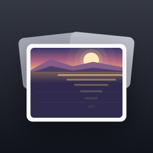
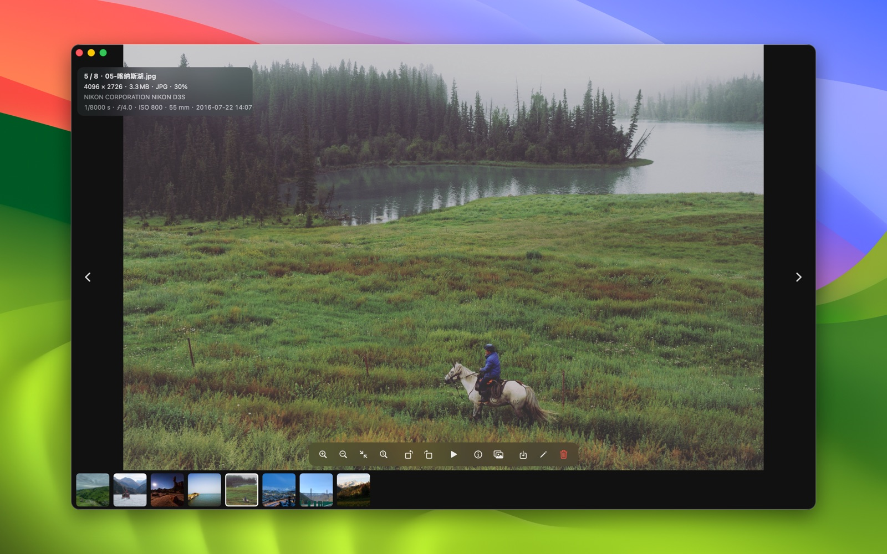
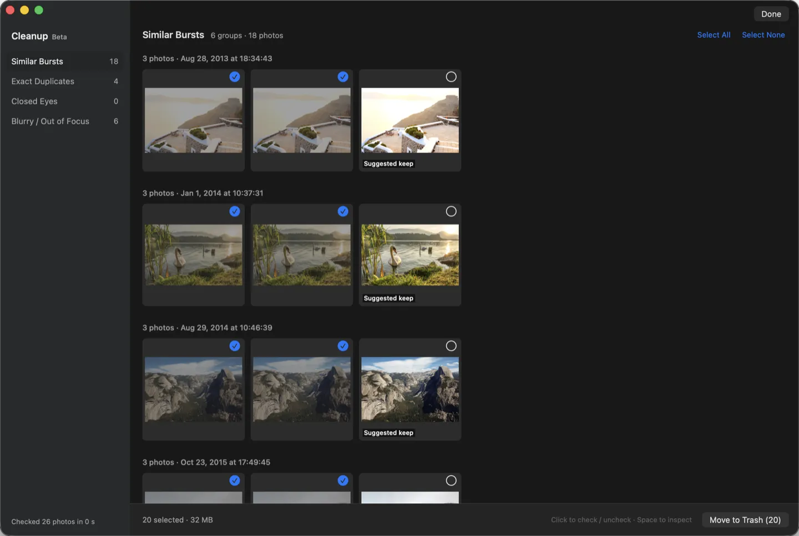

<p align="center">
  
</p>

<h1 align="center">Flipic</h1>

<p align="center"><a href="README.md">简体中文</a> · <b>English</b></p>

<p align="center">
  A lightweight image viewer for macOS. Double-click one photo, then page through the whole folder with the arrow keys.<br>Formerly PixDeck; renamed Flipic in 0.5.0.
</p>

<p align="center">
  <a href="https://github.com/xmasdong/macphoto/releases/latest/download/Flipic.dmg"><b>Download Flipic.dmg</b></a>
  ·
  <a href="https://xmasdong.github.io/macphoto/en/">Website</a>
  ·
  <a href="https://github.com/xmasdong/macphoto/releases">All releases</a>
</p>

<p align="center">
  <a href="https://github.com/xmasdong/macphoto/releases/latest"></a>
  
  <a href="LICENSE"></a>
</p>



Open a single image in Preview and that is all you get: to see the next one, you have to go back to Finder, select the whole set and open it again. Flipic is built for exactly this. Double-click any photo, press → and you are on the next one, across the entire folder. The download is 1.8 MB, the app makes no network connections, and there is no account to create.

## Install

1. Download [Flipic.dmg](https://github.com/xmasdong/macphoto/releases/latest/download/Flipic.dmg)
2. Open the disk image and drag Flipic into Applications
3. The first time you launch it, macOS reminds you the app came from the internet; click Open

Requires macOS 13 Ventura or later, on Apple silicon or Intel. The app is signed with a Developer ID and notarized by Apple. Older versions are on the [Releases](https://github.com/xmasdong/macphoto/releases) page.

To make Flipic your default viewer, open Settings (⌘,) and click Make Default Viewer under General; common image formats and camera RAW are set in one go. You can also Control-click an image in Finder, hold ⌥ and choose Always Open With › Flipic.

Then use it like Quick Look: select a photo in Finder, press ⌘↓ to open it, page with the arrow keys, and press Esc to close (turn on Esc Closes Window in Settings first). The Space key in Finder belongs to the system's Quick Look and can't be taken over by another app.

## Features

**Viewing**

- Page through every image in the folder with ← →, sorted by name, date taken, date modified, date created or file size. Your sort order is remembered.
- Press Space for a Quick Look style preview: the window wraps itself to the photo's aspect ratio. Press Space again to go back.
- Rest the pointer on any detail and press 0 to zoom to 100% right there; press 0 again to go back. Pinch to zoom on the trackpad; double-click also toggles between fit-to-window and 100%. Photos are decoded at screen size first, and the full-resolution original loads only when you zoom in far enough to need it, which keeps memory use low.
- Photos switch instantly when you page; if you like a crossfade, turn on Fade Between Photos in Settings.
- The scroll wheel zooms around the pointer by default. If you would rather flip photos with it, change it in Settings; ⌘ + scroll then zooms. If you reversed your wheel with a tool like Mos, you can reverse the zoom direction too.
- Nothing but the photo by default. Press I for camera, lens, shutter speed, aperture, ISO, date taken, size and color profile; Esc closes it.

**Star ratings**

Press 1 to 5 to give a photo one to five stars; the Rating submenu in the right-click menu has No Rating to clear it. Rated photos show their stars at the bottom center of the window. Ratings are written as standard XMP: into the file itself for JPEG, HEIC and TIFF (metadata only, no recompression), and into a same-name .xmp sidecar for proprietary RAW formats such as Sony, Canon and Nikon, so the RAW file is never touched. Lightroom, Bridge and Capture One read them. A RAW and the JPEG with the same name are rated together.

**Culling (Cleanup Mode, Beta)**

After an event or a conference shoot with hundreds of frames, press ⇧⌘K. Flipic checks the whole folder on your Mac and sorts the results into four groups: similar bursts, exact duplicates, closed eyes, and blurry or out-of-focus shots. In every burst it suggests the sharpest frame where nobody is blinking as the keeper and checks the rest; for closed eyes, it outlines the face it flagged.

Nothing is deleted until you press Move to Trash, and ⌘Z puts the files back. A RAW file and the JPEG with the same name are treated as one photo. Detection can be wrong, so give the selection a quick look before you delete.



**Batch tools and more**

- Convert a whole folder to JPEG, PNG or HEIC; converted files go into a subfolder and the originals stay untouched
- Batch rename
- Rotate and save back to the file; for JPEG and HEIC only the orientation tag changes, so there is no quality loss
- Slideshow with 1, 2, 3, 5 or 10 seconds per photo (set in Settings)
- Export compressed copies, set as desktop picture, move to Trash

**Hand off to your editor**

Pick Photoshop, Lightroom, Capture One or any other app in Settings, then press ⌘E to open the current photo in it. If a RAW file with the same name sits next to the JPEG, the RAW is what gets opened. File › Open With and the right-click menu let you pick a different app on the fly.

To jump between your editor and Flipic, record a global shortcut in Settings › Shortcuts: press it in any app to bring Flipic to the front, and again to hide it.

**Settings and shortcuts**

Every setting lives in one window (⌘,): sorting, crossfade, slideshow interval, Esc behavior, photo editor, scroll wheel and default viewer. Every shortcut can be changed there, and combinations with ⌘ show up in the menus.

**Formats and languages**

JPEG, PNG, HEIC, WebP, animated GIF, TIFF, AVIF, JPEG XL (macOS 14 or later) and common camera RAW formats (ARW, CR2, CR3, NEF, RAF, DNG and more). The interface is available in 14 languages and follows your system setting.

## Keyboard shortcuts

| Key | Action |
|---|---|
| ← → | Previous / next photo |
| ↑ ↓, scroll wheel | Zoom in / out (the wheel can be switched to paging) |
| Space | Preview fitted to the photo; press again to exit |
| 0 | Zoom to 100% at the pointer; press again to fit |
| Double-click | Fit to window / 100% |
| 1–5 | Rate one to five stars |
| I | Photo info panel (Esc also closes it) |
| Esc | Back to fit; with Esc Closes Window on in Settings, closes the window when fitted |
| T | Thumbnail strip |
| R / L | Rotate right / left |
| S | Slideshow |
| Return | Rename |
| ⌘S | Export a compressed copy |
| ⌘⌫ | Move to Trash |
| ⌘E | Edit in your photo editor |
| ⇧⌘K | Cleanup Mode |
| ⇧⌘C / ⇧⌘B | Batch convert / batch rename |
| ⌘, | Settings (change any shortcut here) |

## Privacy

Flipic makes no network connections, has no account and collects no data. It only reads the images you open. Cleanup Mode keeps its analysis in `~/Library/Caches/Flipic` and never writes anything into your photo folders. Only when you rate a photo does Flipic write the rating into its metadata or a same-name .xmp file. All the code is in this repository, so you can check for yourself.

## Building from source

Flipic is written in Swift and AppKit with no third-party dependencies. You need macOS 13 or later and Xcode 15 or the Swift 5.9 command line tools.

```bash
git clone https://github.com/xmasdong/macphoto.git
cd macphoto
./build.sh                 # builds build/Flipic.app with an ad-hoc signature
open build/Flipic.app
```

To work in Xcode, install [XcodeGen](https://github.com/yonaskolb/XcodeGen) and run `xcodegen generate` to create the project.

Signed and notarized release builds come from `scripts/build_devid.sh`. Put your signing credentials in `scripts/devid.env`, following `scripts/devid.env.example`; that file is ignored by git.

### Code layout

```
Sources/Photoview/
  AppDelegate.swift            Menu bar and launch arguments
  ViewerViewController.swift   Main viewer: paging, prefetch, HUD, toolbar, export and batch tools
  ZoomableImageView.swift      Zoom, pan, gestures, keyboard and scroll wheel
  ImageLoader.swift            ImageIO downsampled decoding and memory-aware caches
  FolderModel.swift            File list and sorting
  Filmstrip.swift              Thumbnail strip
  ExifReader.swift             Photo info
  CleanupScanner.swift         Per-photo analysis for Cleanup Mode: sharpness, faces and eyes, feature prints, hashes
  CleanupResult.swift          Grouping, suggested keepers and default selection
  CleanupController.swift      Cleanup Mode interface
  SettingsWindowController.swift  Settings window
  Shortcuts.swift              Customizable shortcuts
  HotKey.swift                 Global shortcut to show / hide Flipic
  Rating.swift                 Star ratings (XMP)
Resources/                     Info.plist, icon, strings for 14 languages
docs/                          Website (GitHub Pages)
scripts/                       Release packaging and test image generators
scripts/icon/                  Icon draft generator, the source photo for its skyline and the final icon
```

A few launch arguments help with debugging without touching the UI:

```bash
Flipic=build/Flipic.app/Contents/MacOS/Flipic
$Flipic --bench <folder>            # paging latency, memory, main-thread stalls
$Flipic --cleanup-report <folder>   # per-photo Cleanup Mode metrics and groups
```

## Contributing

Found a bug, something that feels off, or a feature you want? Open an [issue](https://github.com/xmasdong/macphoto/issues). Pull requests are welcome, translations especially: every language other than Simplified Chinese can be improved by a native speaker.

## License

[MIT](LICENSE). Use, modify and redistribute it freely, in personal or commercial projects, as long as the copyright notice is kept.

---

The icon started as a draft from `scripts/icon/make_icon.py`, which traces the real skyline of a photo taken in Yangshuo, Guilin (Wikimedia Commons, CC0); the final artwork was illustrated over that draft.

Photos in the screenshots are from Wikimedia Commons, all CC0: Santorini by Aidan Meyer and Anthony Delanoix, Lake Bled by Aleš Krivec, Hallstatt by Fineas Anton and Martin Horák, Iceland by Alexandre Godreau, Yosemite by John Salzarulo, Yangshuo by Manon Boyer. The desktop is a built-in macOS wallpaper.
