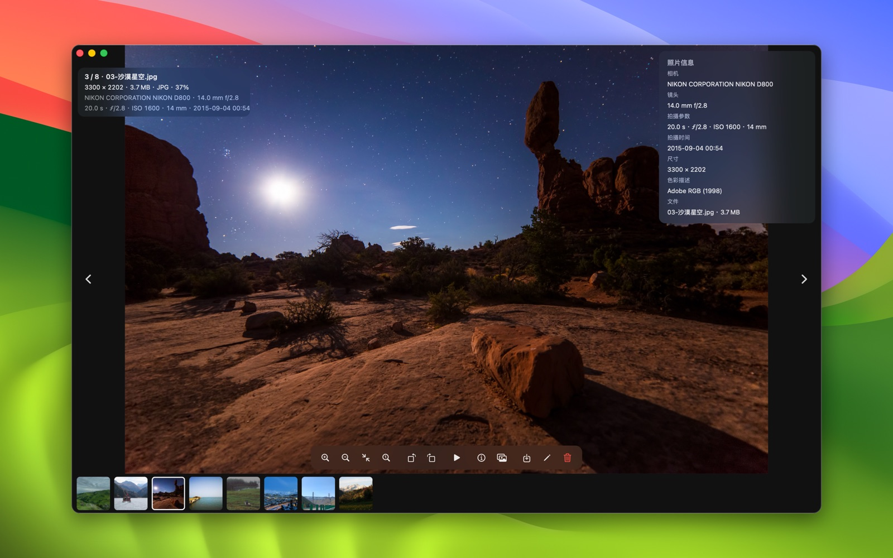

# PixDeck

Mac 上的看图工具，只管看图这一件事。双击任意一张图，就能用左右键把同一个文件夹里的图片翻一遍。

## 下载

**[下载 PixDeck.dmg](https://github.com/xmasdong/macphoto/releases/latest/download/PixDeck.dmg)**（不到 1MB）

- 系统要求：macOS 13 或更新版本，Apple 芯片和 Intel 芯片的 Mac 都能用
- 已通过 Apple 公证，使用 Developer ID 签名
- 历史版本见 [Releases](https://github.com/xmasdong/macphoto/releases)

## 安装

1. 打开下载好的 `PixDeck.dmg`
2. 把 PixDeck 拖进「应用程序」文件夹
3. 第一次打开时，系统会提示这是从互联网下载的 App，点「打开」即可

想把它设成默认看图软件：在 Finder 里右键一张图，选「显示简介」，在「打开方式」里选 PixDeck，再点「全部更改」。jpg、png、heic 等格式各需要设置一次。

## 能做什么

- **连续翻页**：双击一张图，同文件夹的图片按左右键往下翻，可以按文件名、拍摄时间、修改时间、创建时间或文件大小排序
- **缩放**：触控板双指捏合跟着手指缩放，滚轮也可以；空格在适应窗口和 100% 之间切换，放大后自动换成原图
- **拍摄参数**：左上角显示尺寸、大小、相机、镜头、快门、光圈、ISO 和拍摄时间，按 I 打开完整的照片信息
- **批量处理**：整个文件夹批量转换格式（JPEG / PNG / HEIC），转好的放进子文件夹，原图不动；也支持批量重命名
- **其他**：旋转后写回文件（JPEG、HEIC 只改方向标记，画质无损）、导出压缩副本、幻灯片放映、设为桌面壁纸、移到废纸篓
- 支持 JPEG、PNG、HEIC、WebP、GIF（动图）、TIFF、AVIF、JPEG XL（需 macOS 14 或更新）以及常见相机 RAW 格式
- 界面支持 14 种语言，跟随系统设置

## 常用快捷键

| 按键 | 作用 |
|---|---|
| ← → | 上一张 / 下一张 |
| ↑ ↓ 或滚轮 | 放大 / 缩小 |
| 空格 / 双击 | 适应窗口和 100% 来回切 |
| I | 照片信息 |
| T | 缩略图栏 |
| R / L | 向右 / 向左旋转 |
| S | 幻灯片放映 |
| 回车 | 重命名 |
| ⌘S | 导出压缩副本 |
| ⌘⌫ | 移到废纸篓 |

## 隐私

PixDeck 不联网，没有账号，不收集任何数据。只读取你打开的图片，所有处理都在本机完成。

## 反馈

用着有不顺手的地方，欢迎在 [Issues](https://github.com/xmasdong/macphoto/issues) 里告诉我。

---

## English

PixDeck is a lightweight image viewer for macOS. Double-click any image and browse the whole folder with the arrow keys: pinch-to-zoom that follows your fingers, 100% view with full-resolution decoding, EXIF details, batch format conversion, and 14 interface languages. No network access, no account, no data collection.

**[Download PixDeck.dmg](https://github.com/xmasdong/macphoto/releases/latest/download/PixDeck.dmg)** — macOS 13 or later, Apple silicon and Intel, notarized by Apple.

---

截图中的风景照来自 Wikimedia Commons：喀纳斯湖 Muye Ma、那拉提草原 Yoshi Canopus、沙漠星空 thomas shellberg（CC0）；天山天池 David Stanley、库尔德宁 George Lu、博斯腾湖 liuxingy2015（CC BY 2.0）；果子沟大桥 Timothytyy、将军山 Pazakui（CC BY 4.0）。
