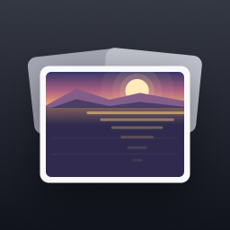
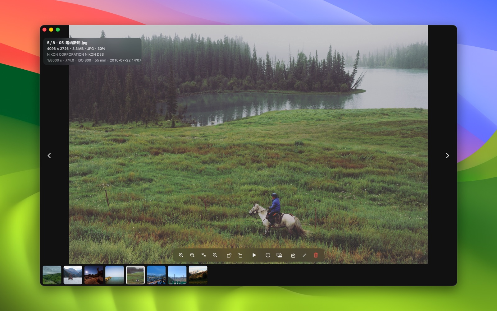
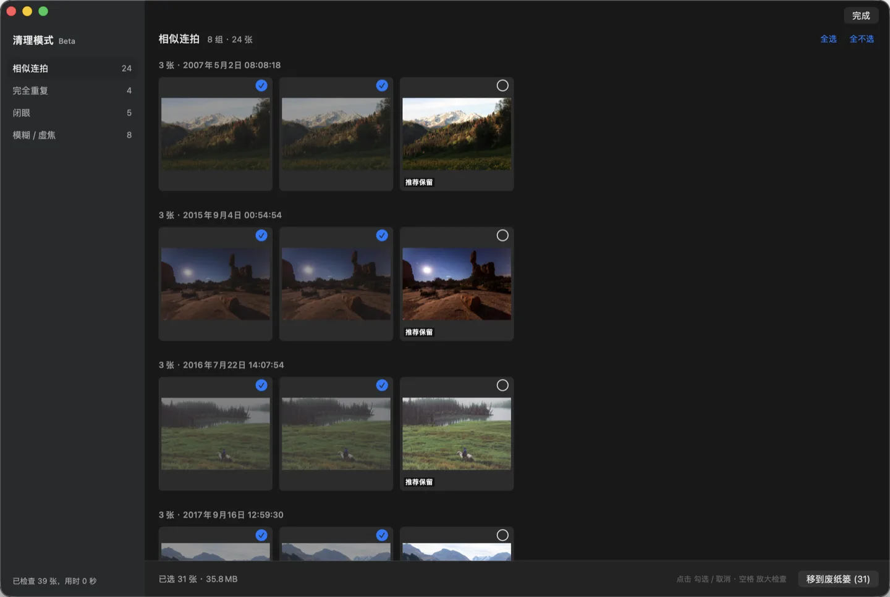
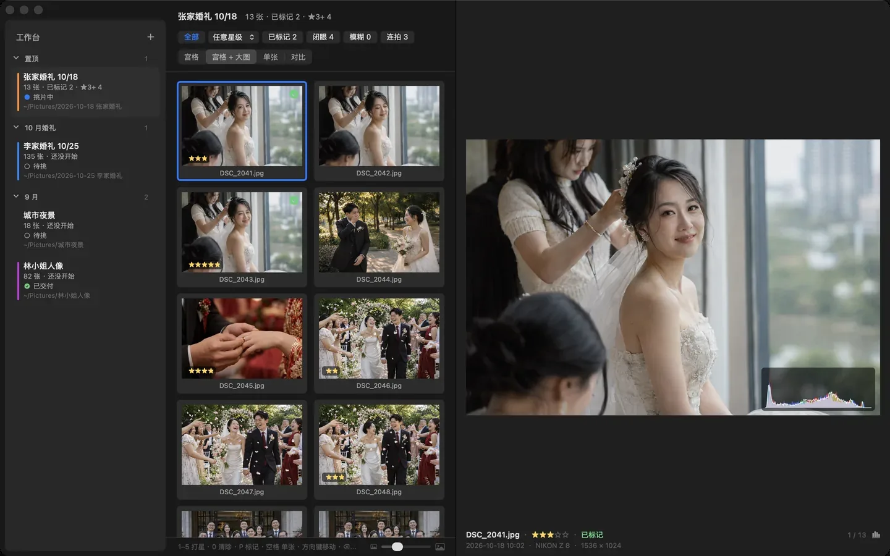

<p align="center">
  
</p>

<h1 align="center">Flipic</h1>

<p align="center"><b>简体中文</b> · <a href="README.en.md">English</a></p>

<p align="center">
  给摄影师挑片用的 Mac 看图软件。导完卡，双击一张，用方向键挑一遍。<br>原名 PixDeck，0.5.0 起改名 Flipic。
</p>

<p align="center">
  <a href="https://github.com/xmasdong/flipic/releases/latest/download/Flipic.dmg"><b>下载 Flipic.dmg</b></a>
  ·
  <a href="https://flipic.app/">官网</a>
  ·
  <a href="https://github.com/xmasdong/flipic/releases">更新记录</a>
</p>

<p align="center">
  <a href="https://github.com/xmasdong/flipic/releases/latest"></a>
  
  <a href="LICENSE"></a>
</p>



拍完一组想先挑一挑，Mac 自带的「预览」只能一张张打开，开 Lightroom 又得先导入。我自己嫌麻烦，就做了 Flipic：双击文件夹里随便一张，左右键往下翻，看中的打个星，回到 Lightroom 里星还在。现在用它的基本都是摄影师，很多功能也是他们提的。安装包 4.1 MB，默认不联网，不要账号。

## 挑一组片大概是这样

1. 卡里的照片拷到电脑上，双击其中一张。不用导入，也不建图库，Flipic 直接读这个文件夹。
2. 用 ← → 翻。看到要确认焦点的，鼠标移到眼睛上按 0，放大到 100%；连拍拿不准留哪张，按 C 两张并排比。
3. 喜欢的按 1–5 打星，要留的按 P 标记。
4. 一场活动几百张的话，按 ⇧⌘K 让清理模式先把相似连拍、闭眼、糊掉的分出来，你再决定删哪些。
5. 挑完按 ⇧P 只看标记过的，或者只看几星以上的，⇧⌘E 一起拷走；要修的几张在底部缩略图栏点第一张、按住 ⇧ 点最后一张选中（⌘ 点加减单张），按 ⌘E 一起在 Lightroom、Capture One 里打开，⌘C 能直接拷贝文件，打过的星在那边还在。

## 为什么这样做

**不导入。** Flipic 不复制照片，也不建自己的图库，关掉就什么都没留下。照片还在原来的文件夹里，你习惯怎么管理就怎么管理。唯一写到别处的是清理模式的检测结果，放在 `~/Library/Caches/Flipic`，删了也没关系。

**星级写成 XMP。** 打的星按 XMP 标准存，Lightroom、Bridge、Capture One 都读得到，换软件不用重新打一遍。JPEG、HEIC 只改文件里的元数据，不重新压缩；相机 RAW 的星级写在旁边同名的 .xmp 文件里，RAW 本身一个字节都不改。

**标记用访达标签。** P 标记的照片打上一个叫 Flipic 的访达标签，不改照片文件。在访达侧边栏点这个标签就能看到全部标记过的照片，不用 Flipic 也找得到。

**翻得快。** 平时只按屏幕需要的尺寸解码，不读整张原图；放大到看得出区别时才去读原图。前后几张在后台一张一张提前准备好，不跟你正在看的那张抢资源。缓存按这台 Mac 的内存大小定上限，8 GB 的机器也不会被吃满。所以 4800 万像素的照片按住方向键一直翻也跟得上。

**同名的文件一起走。** 同时拍的 RAW 和 JPG、RAW 的 .xmp，删除、移动、导出的时候一起处理，不会只删掉一半。

**清理模式在本机跑。** 用的是 macOS 自带的 Vision 框架，在你自己的 Mac 上算清晰度、找人脸和闭眼、比相似度，照片不会上传。它只负责分组和推荐，删哪些你说了算。

## 下载安装

1. 下载 [Flipic.dmg](https://github.com/xmasdong/flipic/releases/latest/download/Flipic.dmg)，国内下载慢可以从[官网](https://flipic.app/)下
2. 打开 dmg，把 Flipic 拖进「应用程序」
3. 第一次打开时系统会提示这是从互联网下载的 App，点「打开」

需要 macOS 13 或更新版本，Apple 芯片和 Intel 芯片都能用。安装包用 Developer ID 签名并通过了 Apple 公证。更新记录在 [Releases](https://github.com/xmasdong/flipic/releases)。

想设成默认看图软件：打开设置（⌘,），在「通用」里点「设为默认看图软件」，常见图片格式和相机 RAW 会一次设好。也可以在访达里右键一张图，按住 ⌥ 键，选「始终以此方式打开」› Flipic。

设好之后可以当「快速查看」用：在访达里选中照片按 ⌘↓ 打开，左右翻看，按 Esc 关闭（先在设置里打开「按 Esc 关闭窗口」）。访达里的空格键是系统的快速查看，第三方 app 接管不了。

## 功能

**看图**

- 挑片：看图时按 P 标记要的照片（同名 RAW 一起标），⇧P 只看已标记的。标记存成访达标签「Flipic」，不改照片文件，在访达侧边栏点这个标签就能全选拖走
- 按星级筛选：「显示 › 只看星级」只看 N 星及以上；筛出来的照片用「文件 › 导出到文件夹…」（⇧⌘E）一次复制或移动走，同名时自动加编号，RAW 的星级文件跟着走
- 并排对比：C 两张、⇧C 四张，各格放大和拖动同步，适合连拍比对焦和表情；按住 ⌥ 可以单独微调某一格，⇧L 关掉同步
- 底部工具条可以在设置里关掉，只用快捷键和菜单
- 可以同时开多个窗口：已经在看照片时，从访达再打开一张会新开一个窗口（设置里可以改回替换当前窗口），「文件 › 新建窗口」⌘N
- 照片里的字可以直接选：在照片上停一下，文字就能选中、复制，右键还能查词、翻译，和系统「预览」一样；整张图的字用「照片 › 复制图中全部文字」（⌥⌘C）。识别在本机完成，快速翻页时不识别；设置 ›「看图」里可以关掉自动识别
- 实况照片：HEIC 或 JPG 旁边有带实况标记的同名 MOV 时，左上角显示「实况」，鼠标移上去就在照片上播放，⌥L 也能播；删除、移动、拷贝、改名时 MOV 跟着照片走，不会把一对拆开
- 按住方向键一路翻也跟得上：每按一下都换图，先出一张略糊的，停下来马上变清晰；内存紧的 Mac 上也一样
- 翻到最后一张会停住、轻轻回弹，不会悄悄绕回第一张；想要循环翻页，在设置 ›「看图」里打开
- 照片适应窗口时，在照片上任意位置按住拖动就是移动窗口；放大后拖动是平移照片
- 鼠标一动，左上角显示文件名，右上角是照片信息、置顶和分享，跟工具条一起出现、一起淡出
- 同一个文件夹里左右翻页，可以按文件名、拍摄时间、修改时间、创建时间或文件大小排序，会记住上次的选择
- 按空格，窗口贴合照片比例预览，跟访达的空格预览一样，再按一次回到原窗口；也可以在设置里打开「打开照片时贴合照片比例」，从访达双击照片就直接是这种窗口，翻页时每张都贴合
- 触控板双指左右滑翻页（往左滑是下一张）；双指捏合缩放；鼠标停在想看的地方按 0，就在那里放大到 100%，再按一次恢复；双击也能在适应窗口和 100% 之间切换，放大到需要时才解码原图
- 翻页默认直接切换，没有渐变；喜欢淡入淡出可以在设置里打开「翻页渐变」
- 鼠标滚轮默认缩放，也可以在设置里改成翻页，翻页方向也能反过来（像刷手机一样往下滑回到上一张）；用 Mos 之类的工具改过滚轮方向的，可以把缩放方向反过来
- 放大后拖到照片边缘就停，不会拖出黑边；底部缩略图有小、中、大、特大四档
- HDR 照片（iPhone 拍的 HEIC、带增益图的 JPEG 等）可以按 HDR 显示，亮部比普通白更亮，和系统「预览」一样；在设置里打开，默认关，需要 macOS 14 和支持 HDR 的屏幕
- 界面默认只有照片，不显示任何信息；按 I 在右上角看相机、镜头、快门、光圈、ISO、拍摄时间、尺寸、色深和拍摄地点（有 GPS 时，点击在「地图」里打开），按 Esc 关掉

**打星**

按 1 到 5 给照片打 1 到 5 星，右键菜单「评分」里可以改成「未评分」。评过分的照片在底部正中常驻显示星级。评分按 XMP 标准写入：JPEG、HEIC、TIFF 写进文件本身，只改元数据不重新压缩；索尼、佳能、尼康等专有 RAW 写在同名 .xmp 文件里，原始文件不动。Lightroom、Bridge、Capture One 都能读到。同名的 RAW 和 JPG 一起打分。

**清理模式**

活动、会议一拍几百张时，按 ⇧⌘K 进入清理模式。Flipic 在本机检查整个文件夹，分成相似连拍、内容完全相同的文件、闭眼、模糊或虚焦四类。连拍组里推荐保留最清楚、没人闭眼的那张，其余默认勾上，闭眼的照片会框出是哪张脸。

删除只在你按下「移到废纸篓」时发生，⌘Z 可以撤销。RAW 和同名 JPG 算一张，一起处理。检测会有误判，删之前过一眼。



**批量处理和其他**

- 整个文件夹批量转换格式（JPEG、PNG、HEIC），输出到子文件夹，原图不动
- 批量重命名
- 旋转后写回文件，JPEG 和 HEIC 只改方向标记，画质无损
- 幻灯片放映，每张停留 1、2、3、5 或 10 秒，切换时渐变 0.5 到 3 秒可调，和手动翻页的渐变分开设置；放映时单击照片暂停、再单击继续，暂停时可以翻看和打星；不动鼠标时缩略图栏和工具条一起隐藏
- 导出压缩副本、设为桌面壁纸、移到废纸篓

**交给后期软件**

在设置里选好 Photoshop、Lightroom、Capture One 之类的软件，之后看到想修的照片按 ⌘E 就用它打开。同名的 RAW 文件也在时，打开的是 RAW。右键菜单和「文件 › 打开方式」里能临时换别的软件。

在后期软件和 Flipic 之间来回切，可以在设置 › 快捷键里录一个全局快捷键：在别的软件里按一下，Flipic 回到最前面；再按一下收起来。

**设置和快捷键**

所有设置都在一个窗口里（⌘,），分通用、看图、鼠标与触控板、快捷键几页。快捷键都可以自己改，也可以设成单个键，比如把「移到废纸篓」改成 Delete 或 D；带 ⌘ 的组合会同步显示在菜单上。

**格式和语言**

JPEG、PNG、HEIC、WebP、GIF 动图、TIFF、AVIF、JPEG XL（需 macOS 14 或更新）、PSD、TGA、OpenEXR，以及常见相机 RAW（ARW、CR2、CR3、NEF、RAF、DNG 等）。系统能解码的其他图片格式也能打开。界面有 14 种语言，跟随系统设置。

## 快捷键

| 按键 | 作用 |
|---|---|
| ← → | 上一张 / 下一张 |
| ↑ ↓、滚轮 | 放大 / 缩小（滚轮可改成翻页） |
| 空格 | 贴合图片比例预览，再按一次退出 |
| 0 | 在鼠标位置放大到 100%，再按一次恢复 |
| 双击 | 适应窗口 / 100% |
| 1–5 | 打 1 到 5 星 |
| I | 照片信息（右上角面板，Esc 也能关） |
| Esc | 回到适应窗口；在设置里打开「按 Esc 关闭窗口」后，适应窗口时直接关闭 |
| T | 缩略图栏 |
| R / L | 向右 / 向左旋转 |
| S | 幻灯片放映 |
| 回车 | 重命名 |
| ⌘S | 导出压缩副本 |
| ⌥⌘C | 复制图中全部文字 |
| ⌘⌫ | 移到废纸篓（可改成单个键） |
| ⌘Z | 放回刚才删掉的照片 |
| ⌘E | 在后期软件中编辑 |
| ⇧⌘K | 清理模式 |
| ⇧⌘C / ⇧⌘B | 批量转换 / 批量重命名 |
| ⌘, | 设置（快捷键都能在这里改） |

## Pro

看图、评星、标记、筛选、导出、并排对比、清理模式一直免费，代码都在这个仓库里（MIT）。

Flipic Pro 是给大量挑片、修图的人准备的，一次买断（¥68），下载的安装包里自带 7 天试用。1.0 起 Pro 多了三样：

- **工作台**（⌥⌘B）：一场拍摄一个项目，宫格里打星、标记、删除，按闭眼、模糊、连拍筛，右边大图带拍摄参数和直方图
- **按内容找照片**（⌘F）：输入「狗」「海边」「夜景」，当前文件夹里拍到的就挑出来；打开「更准的中文识别」后可以搜一句话，比如「海边奔跑的狗」（模型约 141 MB，在设置里一键下载，之后离线）
- **按图里的字找**：搜「发票」「WiFi 密码」，图上有这几个字的照片排在最前面



其余 Pro 功能：按 E 放大到眼睛（往下翻还停在眼睛上）、清理模式里连拍按人比闭眼（每个人跟自己睁得最大的那张比）、修图前后对比（按住 `\` 切换、分割线、透明度）、JPG 和 RAW 合并显示、按星级分到子文件夹、常用文件夹 ⌥1–⌥9 一键送达、删除没挑中的照片、批量送进后期软件、自定义同名关联。免费版已经够大多数人用，Pro 只是给大量挑片、修图的人省点事。Pro 的代码不在公开仓库里，从源码构建出来的是免费版。详见 [flipic.app/pro](https://flipic.app/pro/)。

## 隐私

Flipic 默认不联网，没有账号，不收集任何数据，只读取你打开的图片。只有你点「检查更新…」或在设置里打开「自动检查更新」时，才会向官网请求一个版本号文件（version.json），不发送任何数据（Pro 版顺带从这个文件读取退款后作废的激活码名单）；点「立即更新」才会从 GitHub Releases 下载新版本，校验签名和 Apple 公证后替换自己。清理模式的检测结果存在 `~/Library/Caches/Flipic`，不会往你的照片文件夹里写文件。只有你打星时，才会把评分写进照片的元数据或同名 .xmp 文件。另外三种情况会联网，都由你主动触发：在「关于 Flipic」里发送反馈时，只发送你写的内容、邮箱和 App、系统版本；Pro 版激活时向 pay.flipic.app 登记一次（只发激活码订单号和这台 Mac 设备号的哈希，不含邮箱和电脑名，失败了也不影响激活）；在设置里下载更准的识别模型时，从 GitHub Releases 下载。识别和搜索都在本机完成，照片不会上传。代码都在这个仓库里，可以自己查。

## 从源码构建

用 Swift 和 AppKit 写成，没有第三方依赖。需要 macOS 13 或更新版本，以及 Xcode 15 或 Swift 5.9 命令行工具。

```bash
git clone https://github.com/xmasdong/flipic.git
cd flipic
./build.sh                 # 产出 build/Flipic.app，本机临时签名
open build/Flipic.app
```

想用 Xcode 打开，先装 [XcodeGen](https://github.com/yonaskolb/XcodeGen)，再运行 `xcodegen generate` 生成工程。

要出带签名和公证的安装包，用 `scripts/build_devid.sh`。签名凭据照 `scripts/devid.env.example` 填进 `scripts/devid.env`，这个文件不进版本库。

### 代码结构

```
Sources/Photoview/
  AppDelegate.swift            菜单栏与启动参数
  ViewerViewController.swift   看图主界面：翻页、预取、HUD、工具条、导出与批量处理
  ZoomableImageView.swift      缩放、拖动、手势、键盘与滚轮
  AppInfo.swift                软件名（取自 Info.plist），界面文字统一从这里换名
  LiveText.swift               图中文字：实况文本叠加层、复制全部文字
  LivePhoto.swift              实况照片：找同名 MOV、认实况标记、播放
  ImageLoader.swift            ImageIO 降采样解码与按内存分档的缓存
  FolderModel.swift            文件列表与排序
  Filmstrip.swift              底部缩略图栏
  ExifReader.swift             照片信息
  CleanupScanner.swift         清理模式的逐张检测：清晰度、人脸与闭眼、画面特征、哈希
  CleanupResult.swift          分组、推荐保留与默认勾选
  CleanupController.swift      清理模式界面
  SettingsWindowController.swift  设置窗口
  Shortcuts.swift              可自定义的快捷键
  HotKey.swift                 全局快捷键（显示 / 隐藏 Flipic）
  Rating.swift                 星级评分（XMP）
  UpdateChecker.swift          检查更新（默认关，只请求官网的 version.json）
  Updater.swift                立即更新：下载、校验签名与公证、替换并重新打开
Resources/                     Info.plist、图标、14 种语言的文案
docs/                          官网（GitHub Pages）
scripts/                       签名打包、测试图生成等脚本
scripts/icon/                  图标底稿脚本、山形取材的原图和成品图标
```

调试时可以用这些启动参数，不需要点界面：

```bash
Flipic=build/Flipic.app/Contents/MacOS/Flipic
$Flipic --bench <文件夹>            # 翻页延迟、内存、主线程卡顿
$Flipic --cleanup-report <文件夹>   # 清理模式逐张指标与分类结果
```

## 参与

用着不顺手、发现 bug，或者想要什么功能，都可以开 [Issue](https://github.com/xmasdong/flipic/issues)。PR 也欢迎，尤其是翻译：除了简体中文，其他语言的文案都有改进空间。

## 协议

[MIT](LICENSE)。个人和商业项目都可以自由使用、修改和再发布，保留原作者的版权声明即可。

---

图标先用 `scripts/icon/make_icon.py` 从桂林阳朔的一张照片（Wikimedia Commons，CC0）里提取真实山脊线画成底稿，再照底稿绘制成插画。

截图中的照片来自 Wikimedia Commons，均为 CC0：圣托里尼 Aidan Meyer、Anthony Delanoix，布莱德湖 Aleš Krivec，哈尔施塔特 Fineas Anton、Martin Horák，冰岛 Alexandre Godreau，优胜美地 John Salzarulo，阳朔 Manon Boyer。桌面是 macOS 自带壁纸。
